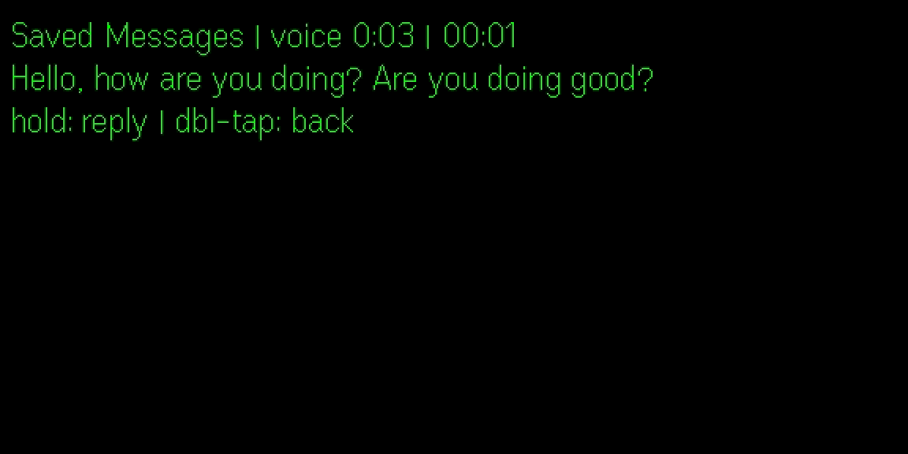
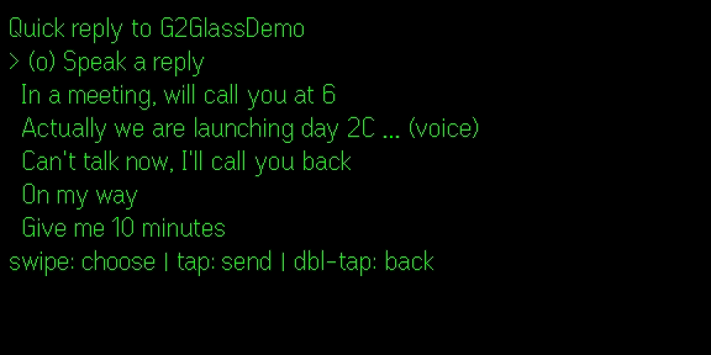
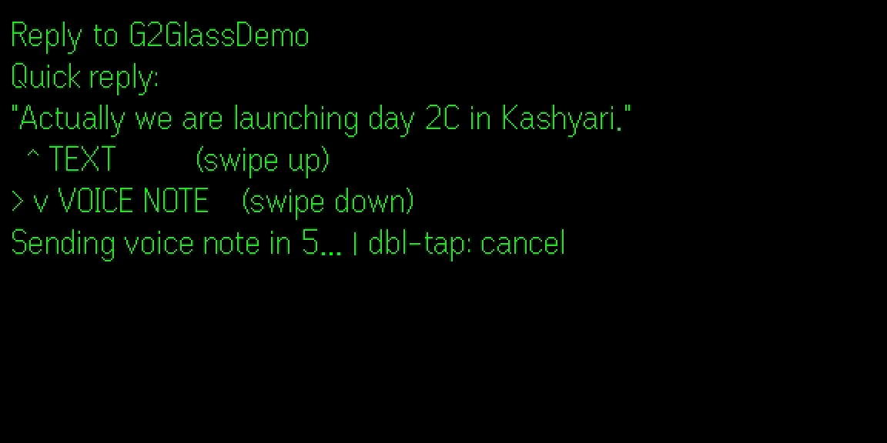
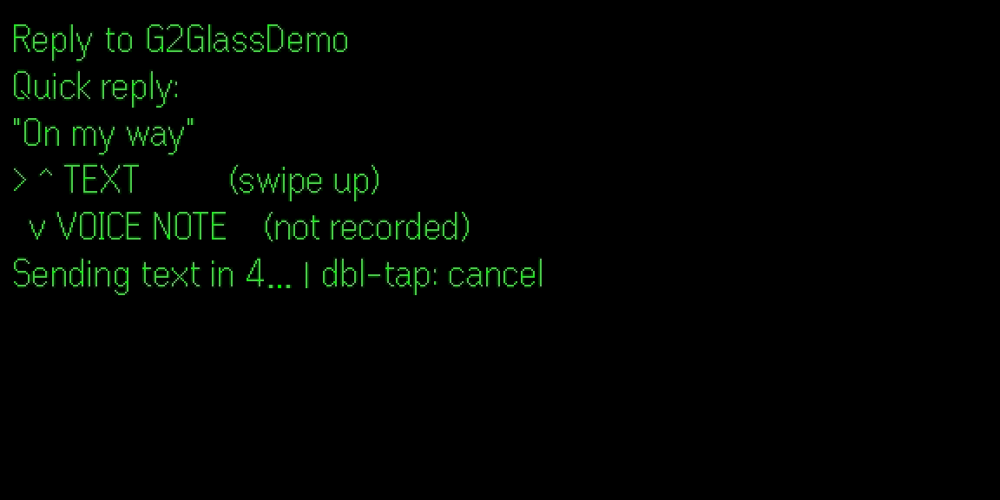
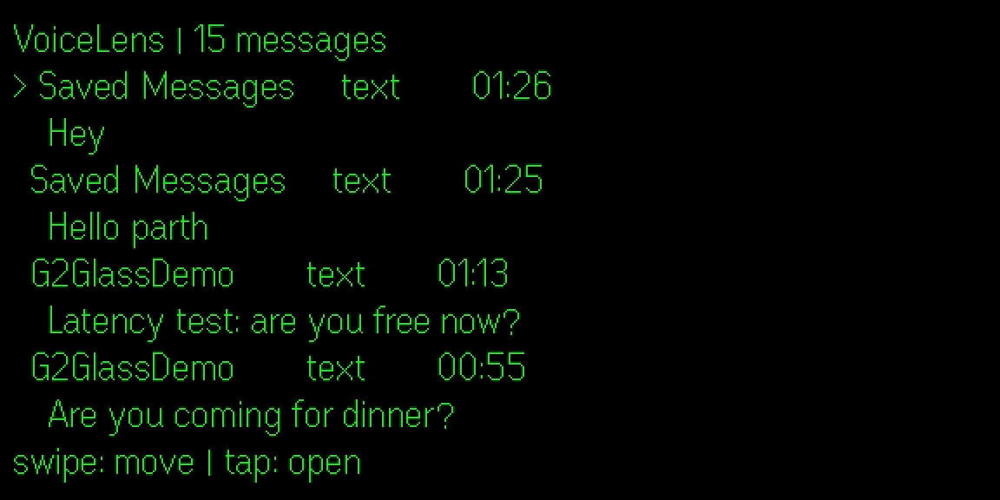
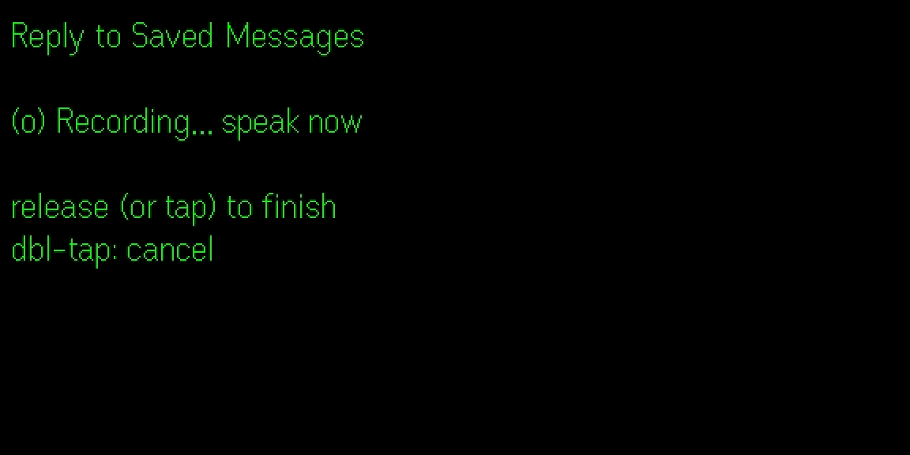
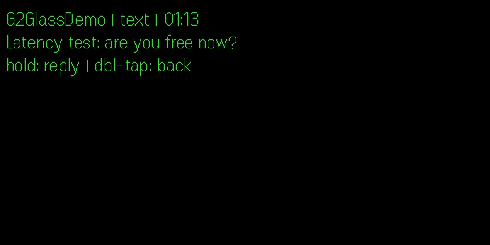
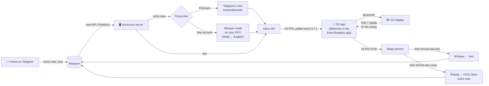

<div align="center">

# 👓 VoiceLens

### Read Telegram voice notes on your Even G2 glasses. Answer in the same format: voice for voice, text for text.

**Heads Up: Even Realities Hackathon** · Track 01 Messaging & News · Best Telegram integration


</div>

---

## The problem in one picture

G2 has a screen and four microphones, but **no speaker**. A Telegram voice note reaches your glasses as a dead end:

<table>
<tr>
<th width="50%">What G2 shows today</th>
<th width="50%">With VoiceLens (real simulator capture)</th>
</tr>
<tr>
<td>

```
Rahul
🎤 Voice message
```
You can't play it. You take out your phone, find earphones, or ignore it. In a meeting, a class or while driving, you can't do any of that.

</td>
<td>



Transcribed on your GPU in **about 0.2 s**. Hindi and Hinglish arrive as **English**, because the G2 font can't draw Devanagari.

</td>
</tr>
</table>

And you can reply without a keyboard or a phone: **hold, speak, release.** If they sent a voice note, they get a voice note back in **your real voice**. If they typed, they get text.

**Can't speak right now?** In a meeting or a class, **tap** instead: pick a **quick reply you recorded once**, and they still hear **your own voice**, without you saying a word.

---

## ⏱️ For judges: the 60-second version

| Judging criterion | Weight | What VoiceLens does | Evidence |
|---|---|---|---|
| **Usefulness on G2** | 30% | Fixes a gap G2 itself creates: no speaker means voice notes are unreadable. Every Telegram user gets voice notes, every day. | [The problem](#the-problem-in-one-picture) · [what's new](#-what-is-actually-new-here) |
| **Read and write** | 25% | Read in one glance; reply with one hold, or **silently with one tap** (quick replies in your own recorded voice). The reply **matches the sender's format**, and one swipe switches it. No typing, no AI-written words. | [The two flows](#-the-two-flows) · [Silent quick replies](#-silent-quick-replies-in-your-own-voice) |
| **Technical execution** | 20% | 207 automated tests written before the code, plus a 26-check end-to-end run repeated 11 times on the real setup. GPU Whisper with CPU fallback, measured latency, warm-up and keep-alive tuned from real benchmarks. | [Measured, not claimed](#-measured-not-claimed) · [Tests](#-tests) |
| **UX for display and voice** | 15% | Plain-ASCII screens sized to 576×288, direction-based choices that survive G2's touch misfires, and a 5 s undo on every send. | [Built for G2's real limits](#-built-for-g2s-real-limits) |
| **Business potential and safety** | 10% | Only chats you pick. Nothing sends without the countdown. Voice notes are never marked "listened". Secrets stay on your machine. | [Privacy and Telegram rules](#-privacy-and-telegram-rules) |

---

## 🔁 The two flows

You always **read text** on the glasses and always **reply by speaking**. VoiceLens decides how the reply goes out.

| Your friend sends | Glasses show | You do | They receive (default) | Swipe to switch to |
|---|---|---|---|---|
| 🎤 **Voice note** | The note as text (transcribed, Hindi → English) | Hold + speak | 🎤 **A voice note in your voice** | 💬 Text (swipe up) |
| 💬 **Text** | Their text, instantly | Hold + speak | 💬 **Text** (your speech, typed) | 🎤 Voice note (swipe down) |

**The preview, exactly as the app draws it** (output of the real `render()` code):

```
Reply to G2GlassDemo                    Reply to G2GlassDemo
You said:                               You said:
"Yes, I'll be there with both."         "Yes, I'll be there with both."
  ^ TEXT          (swipe up)            > ^ TEXT          (swipe up)
> v VOICE NOTE    (swipe down)            v VOICE NOTE    (swipe down)
Sending voice note in 5... | dbl-tap    Sending text in 5... | dbl-tap: cancel
        they sent a voice note    ── swipe up ──▶    you chose text
```

**Swipe up is always text, swipe down is always voice.** It's not a toggle, so a double-read swipe can't flip it back. A tap does nothing here, double-tap cancels, and doing nothing sends after 5 seconds.

---

## 🤫 Silent quick replies, in your own voice

In a meeting, a class or a library you can **read** a voice note on G2, but you **can't speak** to answer. Quick replies fix that:

1. **Once:** record a few short replies on the dashboard (*"On my way"*, *"Can't talk now, I'll call you back"*). Leave the text empty and **Whisper writes it from your recording**.
2. **On the glasses:** open a message and **tap**. Pick a reply with a swipe, then tap.
3. **They get your voice:** if they sent a voice note, they hear **your real recorded voice**; if they typed, they get text. Same 5 s preview, same swipe to switch.

| Quick reply list | Preview: your recorded voice | Text-only reply |
|---|---|---|
|  |  |  |

- **"Speak a reply" is the first row,** so you can also record **without long-press**, which real G2 sometimes reserves for its system menu.
- **No speech, no AI at send time:** the clip and its text are ready, so tap → preview takes **0.4–0.7 s**.
- **Text-only replies** are marked `(not recorded)` for voice, and swipe down can't pick it.
- **A reply deleted on the dashboard while the list is open** shows a clear error and sends nothing ([screenshot](docs/screenshots/08-quick-error.png)).

---

## 📸 Screens (real captures from the official Even Hub simulator)

| Inbox | Voice note, as text |
|---|---|
|  |  |
| **Recording your reply** | **A friend's text** |
|  |  |

---

## 🧠 How it works



- **The glasses do three things:** show text, record audio, report gestures. Everything heavy runs on the server.
- **Hybrid transcription:** Telegram's own transcription when you have Premium (audio never leaves Telegram). Our free test account got 0 Telegram transcriptions a week (`transcribe_audio_trial_weekly_number = 0`), so VoiceLens falls back to Whisper running locally on your GPU.
- **Your speech becomes either format:** the same recording is transcribed for the on-glasses preview, and converted to a real Telegram voice note when that's the chosen format.

---

## 🆕 What is actually new here

Telegram on G2 isn't new: at least seven public projects (several in this hackathon) show a Telegram inbox and let you **dictate a text reply**. What none of them do:

| | Other G2 Telegram apps | **VoiceLens** |
|---|---|---|
| Read text messages | ✅ | ✅ |
| **Read incoming voice notes** | ❌ G2 can't play them | ✅ **text in about 0.2 s, Hindi → English** |
| Reply by speaking | ✅ always sent as text | ✅ |
| **Reply as a real voice note in your voice** | ❌ | ✅ |
| **Reply silently with your own recorded voice** | ❌ | ✅ quick replies |
| **Reply format follows the sender, swipe to switch** | ❌ | ✅ |
| Works without Telegram Premium | n/a | ✅ local GPU Whisper |

<sub>Checked on Nov 25, 2026 against 154 public G2 repositories on GitHub; the READMEs of the 9 closest Telegram projects (TapBack, GlanceReply, Glance Desk, PaperPlane, paper-plane, PulseGlass, Glance Inbox, Heads Up, ERGram) do not mention voice notes. Private code may differ.</sub>

---

## 📏 Measured, not claimed

All numbers were measured on the development laptop (Intel i5-12450H, RTX 4050 6 GB) with real voice notes from a real Telegram account.

| What | Result | How it was measured |
|---|---|---|
| Voice note → text, **GPU** | **0.17 – 0.25 s** per 1–5 s note | 6 real notes, best of 2 warm runs |
| Voice note → text, CPU | ~3.1 s | Same 6 notes. Whisper's fixed 30 s window sets a ~3 s floor on CPU |
| GPU after 20 s idle, no keep-alive | 1.22 – 1.36 s | The GPU clocks down when idle |
| GPU after 20 s idle, **with keep-alive** | **0.29 – 0.33 s** | A 0.1 s ping every 2 s while the app is open |
| Your speech → preview on glasses | **0.61 s** | Real 4 s recording through `/reply/prepare` |
| Send → appears on the friend's phone | **0.47 s** | Timed until the friend's chat received it |
| Quick reply: tap → preview on glasses | **0.41 – 0.69 s** | 11 end-to-end runs on the real setup |
| Quick reply: countdown end → friend has it | **0.19 – 0.26 s** | Same 11 runs (after the 5 s undo) |
| Friend's message → VoiceLens inbox | **1.14 s** | Plus up to 0.7 s for the glasses to poll |
| Hinglish → English (6 s note) | ✅ accurate | *"Bhai kal ki meeting 5 baje shift ho gayi hai, laptop aur charger dono leke aana"* → **"Brother, the meeting tomorrow has shifted to 5 o'clock. Bring the laptop and charger both and tell Raul."** |
| Very short notes (~2 s) | ⚠️ can be wrong | *"5 baje"* once became *"5 am"*. Short notes need a "check" mark (roadmap) |

**Model choice was tested, not guessed:** `base` was fast on English but garbled Hinglish into Urdu script, and `small` without translation produced Devanagari that G2 can't display. **`small` + translate** won on every note.

---

## 🛠️ Built for G2's real limits

Each decision below comes from a G2 constraint or a real bug found while testing:

| G2 reality | Design decision |
|---|---|
| No speaker | Voice notes are **read**, never played |
| One firmware font that drops unknown characters | Plain ASCII screens, no emoji (quick reply labels are cleaned too: *"In a meeting 🙏, call at 6"* → *"In a meeting, call at 6"*). Hindi is **translated to English**, not transliterated |
| The font is **proportional** | No space-padded columns (they drift); rows use `name \| kind \| time` and `label (voice)` |
| Touch gestures get misread (4 of 5 reviews complain) | **Direction = choice** (up = text, down = voice), not a toggle; **no single tap ever sends**; every send has a **5 s undo** |
| Text longer than the screen is scrolled by the firmware, and the swipe never reaches the app | Every screen is capped at **48 × 10 characters**, and a test enforces it, so swipes always arrive |
| The system claims "tap + hold" for its own menu | Tap opens quick replies, whose first row **"Speak a reply"** records without long-press |
| Double-tap is the usual "exit" gesture | On the inbox it **jumps to the newest message** instead. One misplaced double-tap used to close the whole app during testing |
| The simulator sends stray scroll events during a hold | Swipes are ignored while recording |
| Apps can't show anything while closed | Roadmap: an alert bot, so G2's built-in Telegram notifications carry the text |

---

## 🔒 Privacy and Telegram rules

- **Only chats you pick** are read (`server/watched_chats.json`, default: your Saved Messages).
- **Nothing is sent without the countdown,** and replies go only to picked chats.
- **Voice notes are never marked "listened"** (`messages.readMessageContents`): you read a transcript, so marking it as heard would mislead the sender. API Terms 1.4 forbid faking read status.
- **No message text is stored on disk.** The inbox lives in memory.
- **Secrets never reach the glasses app:** keys and the Telegram session stay in `server/` (gitignored).
- **Honest grey area:** Telegram API Terms 1.5 restrict using Telegram data for "deployment of" AI. Premium users get Telegram's own transcription (no third-party AI). The free-account fallback runs Whisper **locally on your own machine** (no third-party service, no training), and we state it here openly instead of hiding it.

---

## 🚀 Quickstart

**Needs:** Node 20.17+, Python 3.11+, a Telegram account. An NVIDIA GPU is optional (CPU works, about 3 s per note).

```powershell
# 1. Install
cd g2-app;  npm install;  cd ..
cd server;  python -m venv .venv;  .venv\Scripts\python -m pip install -r requirements.txt;  cd ..

# 2. Telegram credentials (your own, from https://my.telegram.org)
copy server\env.example server\.env     # fill TELEGRAM_API_ID and TELEGRAM_API_HASH
server\.venv\Scripts\python server\login.py   # phone number + code, once

# 3. Run everything (server, glasses app, dashboard, simulator)
powershell -ExecutionPolicy Bypass -File .\start-dev.ps1
```

Open **http://127.0.0.1:8800**: the live dashboard shows the glasses screen, your inbox and controls (↑ ↓ Enter Esc, **hold Space to talk**), plus every test result.

<details>
<summary><b>Demo friend bot</b> (for recording a two-sided demo)</summary>

1. Create a bot with **@BotFather**, then press **Start** in its chat.
2. Run `server\.venv\Scripts\python server\set_bot_token.py`. It reads the newest token from your BotFather chat and writes it to `server\.env` without printing it.
3. Restart the server and dashboard. The **"friend's phone"** panel can then send texts and recorded voice notes as that bot, and shows your replies labelled *"from G2 glasses"*.

</details>

---

## 🧪 Tests

Every feature was built **test-first**: a failing test was written and committed before the code that makes it pass. The commit history shows each `test:` commit before its matching `feat:` / `fix:` commit.

| Suite | Tests | Covers |
|---|---|---|
| Server (pytest) | **139** | Telegram transcription and quota errors, hybrid fallback, GPU/CPU selection, warm-up, keep-alive, inbox, reply drafts and sending, quick replies (store, voice clips, API), the API, OGG Opus conversion, token safety, dashboard controls |
| Glasses app (Vitest) | **68** | Gesture classification (including the "tap arrives with no event type" protobuf quirk), screen layout limits, no padded columns, navigation, the reply and quick-reply state machine, API client |

```powershell
cd server; .venv\Scripts\python -m pytest -q        # 139 passed
cd g2-app; npm test                                 # 68 passed
```

---

## 📁 Repository map

| Path | What |
|---|---|
| `g2-app/src/gestures.ts` | Raw G2 events → tap / double-tap / swipe / hold |
| `g2-app/src/screens.ts` | Inbox and message screens, sized for 576×288 |
| `g2-app/src/nav.ts` | The whole UI as a pure state machine, including the reply flow |
| `g2-app/src/main.ts` | Side effects: microphone, upload, countdown, send |
| `server/voicelens/transcribe.py` | Telegram's `transcribeAudio` with polling and quota handling |
| `server/voicelens/local_whisper.py` | Whisper on GPU/CPU, warm-up, keep-alive, translation |
| `server/voicelens/hybrid.py` | Telegram first, local Whisper when Premium is missing |
| `server/voicelens/reply.py` | Format rule, draft → send, PCM → OGG Opus |
| `server/voicelens/quick_replies.py` | Saved quick replies: text + your voice clip |
| `server/run.py` | One process: Telegram listener + transcription + API |
| `server/devtools/` | Live dashboard, speed listener, demo-friend bot |

---

## 👓 Running on real G2 glasses

The app uses only the official Even Hub SDK, so the code is the same on hardware. One thing changes: on a phone, `127.0.0.1` means the phone itself, so the server has to be reachable from it, either on the same Wi-Fi or through an HTTPS tunnel. Then run `npx evenhub qr --url http://<laptop-ip>:5173` and scan the code in the Even Realities app. Still to confirm on hardware: long-press reliability, mic quality in noise, and Bluetooth latency.

---

## 📨 Feature requests for the platforms

| For | Request | Why |
|---|---|---|
| Even Hub | A user-approved way to show one short card while the app is in the background | A voice note can't reach you unless VoiceLens is already open |
| Even Hub | Built-in speech-to-text | Every team rebuilds STT; VoiceLens needed a GPU server for sub-second results |
| Even Hub | A `measureText(content, width)` call | The proportional font makes line fitting guesswork; overflow silently swallows swipes |
| Even Hub | Always send `eventType` on taps | A tap arrives with no event type (protobuf drops 0), which every app has to rediscover |
| Telegram | Free voice-note transcription for wearable clients | Our free account got 0 transcriptions a week, which forces a local-AI fallback |

---

## 🗺️ Roadmap

- [ ] **Alert bot:** important voice notes reach the glasses as G2 notifications even when VoiceLens is closed
- [ ] **"Check" mark** on notes under 3 s, where transcription is least reliable
- [ ] **Custom vocabulary** (names, "D2C", "FundNexus") to fix proper-noun errors
- [ ] **Phone page** to pick watched chats
- [ ] **Hosted server** behind an HTTPS tunnel, for real G2 hardware

---

## 📜 Prior work (built during the hackathon)

All project code in this repository was written from **Nov 24, 2026**, during the hackathon week. Pre-existing work used:

- [even-realities/evenhub-templates](https://github.com/even-realities/evenhub-templates) (MIT): the `asr` template was the starting point for `g2-app/`
- Open-source libraries in `g2-app/package.json` and `server/requirements.txt`: Even Hub SDK, Vite, Vitest, FastAPI, Telethon, faster-whisper, imageio-ffmpeg, pytest
- Built with AI coding assistance (Claude Code)

<div align="center">

**VoiceLens** · made for the Heads Up: Even Realities Hackathon · by [@parthpawar1117](https://github.com/parthpawar1117)

</div>
